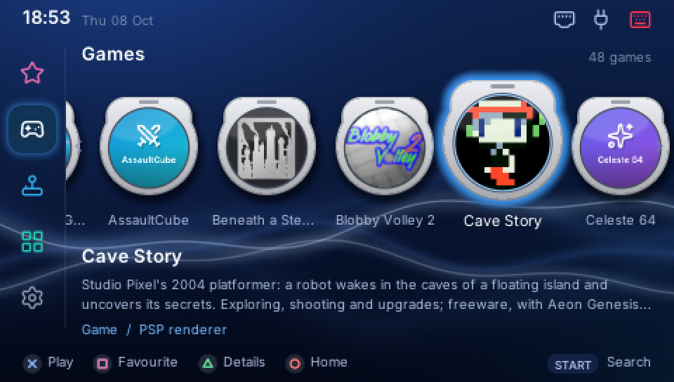
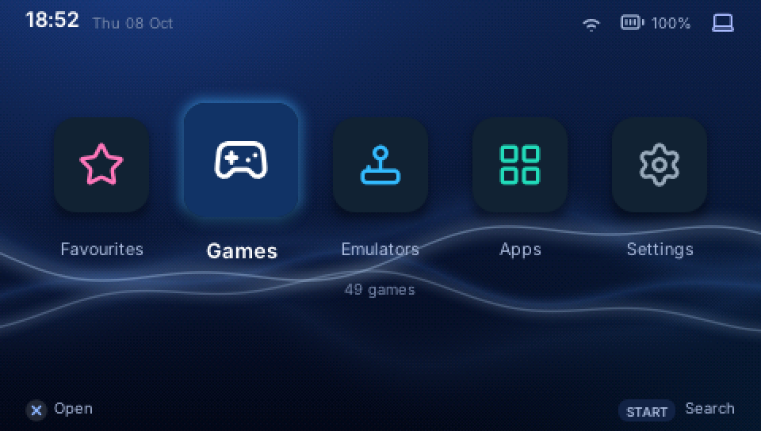
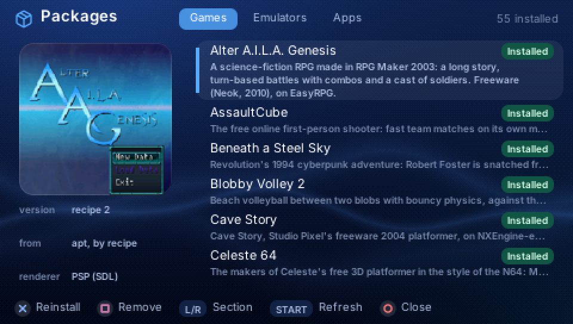
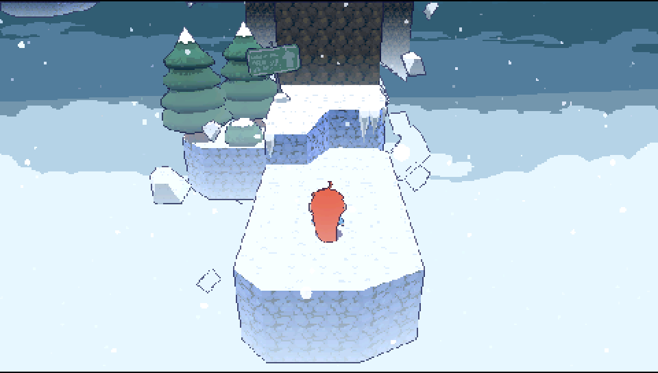
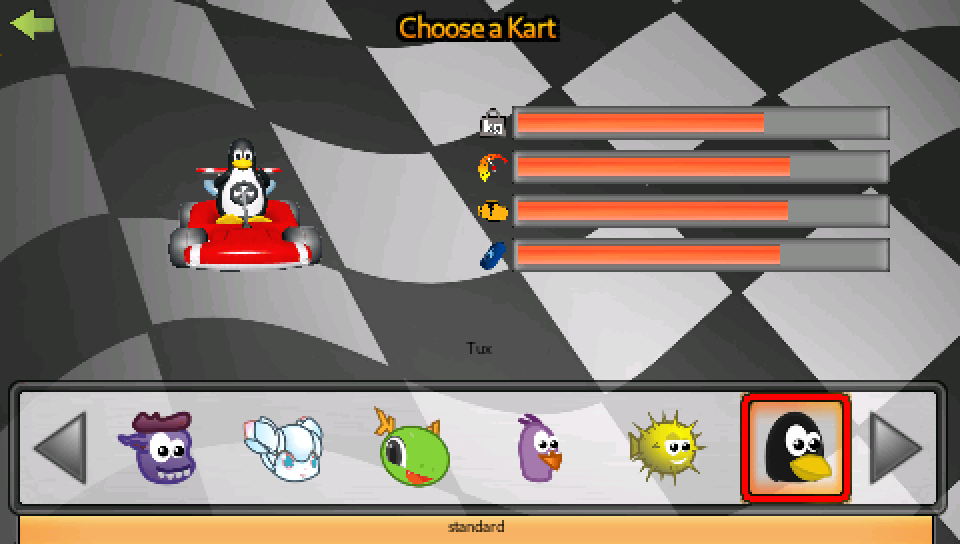

# PSPExp

**Exp**and your PSP by giving it a sidekick: a small Linux board, such as
a Raspberry Pi, plugged into its USB port. The board does the thinking and
runs the games; the PSP does what it is good at, drawing them with its own
graphics chip, playing their sound and taking your input. Together they play
games the PSP never had, and even a tiny board keeps up.

What you get on the PSP:

- **A launcher made for it**: games, emulators, apps and settings, with
  covers, favourites and search, all driven by the PSP's buttons.
- **Games the PSP never had**, installed from the PSP in a couple of
  presses: Doom (Freedoom), Quake, Celeste 64, Unreal Tournament, Diablo,
  Sonic Robo Blast 2, Cave Story, OpenTTD, Command & Conquer, Warcraft I
  and II (with your own copy's data), SuperTux, and
  [dozens more](docs/manual/raspberry-pi.md#what-it-plays-like).
- **Emulators**: NES, SNES, Mega Drive, Game Boy (Color, Advance), Lynx,
  WonderSwan and, on a Pi, the Nintendo 64. Bring your own ROMs.
- **A music player, a file manager and a Linux terminal**, plus Bluetooth
  headphones on boards that have Bluetooth.

| | |
|---|---|
|  |  |
| The launcher's home screen | Packages: install games from the PSP |
|  |  |
| Celeste 64, drawn by a Raspberry Pi's GPU | SuperTuxKart, the same way |

What the PSP shows, captured from the stream the board sends it.

## What you need

- A **PSP-1000** with **custom firmware**. PSPExp loads a small USB
  driver, which the official firmware does not allow. Other PSP models
  have not been tried.
- A **mini-USB data cable** (not a charge-only one).
- One of these boards:

| Board | Good for | Setup |
|---|---|---|
| **Raspberry Pi 400 / 4 / 5** | the most games, 3D included | a card image |
| **ClockworkPi GameShell** | a pocket pair: the PSP plus a handheld board | a card image |
| **Onion Omega2+** | the smallest and cheapest; 2D games and emulators | installed from a computer |

## Getting started

1. [Prepare the PSP](docs/manual/psp.md): install PSPExp on its memory stick. You only do this once.
2. Set up the board: [Raspberry Pi](docs/manual/raspberry-pi.md),
   [GameShell](docs/manual/gameshell.md) or [Omega2+](docs/manual/omega2.md).
3. Start PSPExp on the PSP and plug the cable into the board. The launcher appears.
4. In the launcher, open **Apps > Packages** and install a game.

[Using PSPExp](docs/manual/using-pspexp.md) covers the rest: buttons,
packages, ROMs, files, music and headphones.

## Status: not released yet

PSPExp works, but only the package repository is public so far
(`https://pkg.pspexp.dev`, where the games come from): there is no PSP
download and no card image to download yet. Until those exist, you build them from this repository
on a Mac or a Linux computer. That needs the
[pspdev](https://github.com/pspdev/pspdev) toolchain for the PSP side, and
the board guides name the scripts to run. The first release will turn the
steps above into downloads.

Tested on: PSP-1000, Raspberry Pi 400, GameShell, Omega2+.

## How it works, briefly

The game runs on the board, unmodified, and draws through SDL2 or OpenGL
as usual. PSPExp's layer catches those calls and sends the PSP what to
draw, not the finished pixels: textures once, then small lists of sprites
each frame. The PSP's graphics chip draws them at full speed, its sound
chip plays the mixed audio, and its buttons go back to the game as a
controller. Games too heavy for the PSP's chip are drawn by the board's GPU
instead, and each finished frame is sent as a picture.

## Documentation

| If you want to... | Read |
|---|---|
| set it up and play | [the user manual](docs/manual/README.md) |
| type commands on the board | [the cheatsheet](docs/cheatsheet.md) |
| build it, change it, run the tests | [Developing PSPExp](docs/Developing.md) |
| understand the design | [the technical architecture](docs/PSPExp_Technical_Architecture.md) |
| find any other document | [docs/README.md](docs/README.md) |

## Licence

PSPExp is under the [MIT licence](LICENSE). A few files keep their own
(patches to other projects, fonts, the GameShell's Wi-Fi settings):
[THIRD_PARTY.md](THIRD_PARTY.md) lists them. Games come from their authors, under their own
terms; none are in this repository.

PSPExp is not made by or affiliated with Sony. "PSP" names the console it
runs on.
