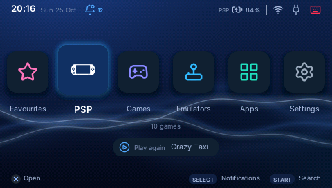

# Your PSP games

**Keep your PSP games on the board and play them on the PSP, no copying to
the memory stick.** They show up in the launcher's **PSP** section, each with
its own icon. Choose one and the PSP runs it itself, at its own speed, reading
the game's disc from the board over the USB cable. Leave the game and you are
back in PSPExp.

## What you need

- A PSP with **PRO custom firmware** (tested on a PSP-1000 with 6.60 PRO-C;
  ARK has not been tried yet).
- PSPExp up to date on the board (Apps > Packages) and on the PSP
  (Settings > Update the PSP, when the launcher offers it).
- **The PSPExp plugin switched on**, once: **Settings > This PSP > PSPExp
  plugin**, cross ([more about the plugin](plugin.md)).
- Your own PSP games as **ISO** or **CSO** files, or a **zip** holding one.

## Quick start

1. Copy your games into the **`roms/psp`** folder of the board's home folder
   (on a Raspberry Pi, `/home/pi/roms/psp`): with **Apps > Files** from a USB
   stick plugged into the board, for example.
2. Open the **PSP** section, the first after Favourites on the home screen
   (the launcher opens on it).
3. Choose a game and press cross. PSPExp hands the PSP over and the game
   starts as from the XMB.
4. To come back, press **HOME** and choose **Exit Game**: PSPExp starts again
   by itself.

A zipped game is unpacked once on the board the first time you start it (the
launcher shows "Preparing" with its progress). The board keeps a few unpacked
games and removes the oldest when it needs the room.

## Good to know

- **Speed:** the games start as fast as from the memory stick and play the
  same. Only a loading screen can take a moment longer.
- **Recording works** in these games too: ♪ + L
  ([Recording your games](recording.md)).
- **Keep the PSP plugged in.** The game's disc is on the board: if the cable
  comes out while you play, the game waits until it is back. If the board is
  not there when a game starts, the PSP waits a minute and a half, then goes
  back to PSPExp.
- **Saves** are the PSP's own, on its memory stick, as for any game.
- PS1 games in the same folder are left out of the section for now.
- Tested so far: Ace Combat X, Bomberman, Burnout Legends, Despicable Me, Gran
  Turismo, Pro Evolution Soccer 2014.

## If something does not work

- **"Switch on the PSPExp plugin first"**: Settings > This PSP > PSPExp
  plugin is Off. Turn it on and choose the game again.
- **"PSP games need PSPExp on the PSP updated"**: Settings > Update the PSP.
- **The game stays on a black screen:** check the cable and that the board is
  on; see [the plugin's page](plugin.md).
