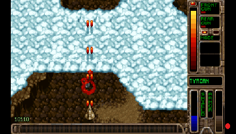
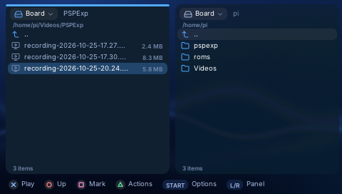

# Recording your games

**Press ♪ + L to record what you play, with its sound.** It works in
everything PSPExp runs (its games, emulators, apps, the launcher) and in your
own PSP games, from a UMD, an ISO on the memory stick or the launcher's
[PSP section](psp-games.md). The videos are saved on the board, ready to
watch on the PSP or copy anywhere.

## Quick start

**In PSPExp:**

1. Press **♪ + L**: a red dot appears in the bottom-right corner.
2. Play.
3. Press **♪ + L** again: the dot goes and the video is saved.

**In your own PSP games** (UMD, ISO, the PSP section), the same, with two
things first:

- Once: switch on the PSPExp plugin in **Settings > This PSP > PSPExp
  plugin** (it needs PRO custom firmware; [the plugin](plugin.md)).
- Keep the PSP plugged into the board, and wait until the game has started:
  ♪ + L does nothing in its first seconds (up to 20).

Press **♪ first**, then L, briefly: the game does not see the L. ♪ on its own
still does what it always did (the sound on and off; in the launcher, the
music).

## Where the videos go

Into **Videos/PSPExp** in the board's home folder (on a Raspberry Pi,
`/home/pi/Videos/PSPExp`), named by date and time, for example
`recording-2026-10-25-20.24.26.mp4`. They are MP4 files with sound, at the
PSP's 480x272, up to 30 pictures a second.

- **Watch one on the PSP:** **Settings > Recording > Videos** opens the folder
  in Files; choose a video and it plays full screen.
- **Copy one to a computer:** in Files, show the PSP's memory stick in the
  other panel, select the video and choose **triangle > Copy**. Then connect
  the PSP to the computer in USB mode as usual.

## The last 30 seconds (Clips)

For the moment you did not plan: turn on **Settings > Recording > Clips**,
and **♪ + R** saves the last 30 seconds (a green dot for a second). The board
then records all the time in the background, which costs a little (a game can
run a few pictures a second slower, the board works harder), so it is off at
first.

| Press | What happens | You see, bottom right |
|---|---|---|
| ♪ + L | a recording starts | a red dot, while it records |
| ♪ + L again | the recording stops and is saved | the red dot goes |
| ♪ + R | the last 30 seconds are saved (Clips on) | a green dot, for a second |

## Good to know

- The dot is only on the PSP's screen, never in the videos.
- In a game's heaviest scenes, the video gets fewer pictures for a moment so
  that the game keeps its own speed.
- Games that run at 60 pictures a second are recorded at 30.
- On a GameShell the videos are less smooth than on a Raspberry Pi (its USB
  is slower); the games run as fast.
- Own PSP games recorded so far: Ace Combat X, Bomberman, Burnout Legends,
  Castlevania: The Dracula X Chronicles, Crisis Core, Gran Turismo, Jeanne
  d'Arc, Lunar: Silver Star Harmony, Phantasy Star Portable 2.

## If something does not work

- **No dot:** check that the PSP is plugged into the board. In your own PSP
  games, check that the PSPExp plugin is On (Settings > This PSP) and that the
  game has started. Keep PSPExp up to date on the board (Apps > Packages) and
  on the PSP (Settings > Update the PSP).
- **The dot goes out by itself:** the board stopped hearing the PSP. What was
  recorded is saved; the plugin reconnects after a few seconds, and ♪ + L
  starts a new recording.

## Without a board

A Mac or a Linux computer can do the recording instead: the program is
`pspexp-plugin-host`, built from PSPExp's source ([Developing](../Developing.md)).
`pspexp-plugin-host -k -s ~/Movies/PSP` keeps ♪ clips and recordings in that
folder (add `-b 0` for ♪ + L recordings only); `pspexp-plugin-host -o game.mp4`
records a whole game into one file.
